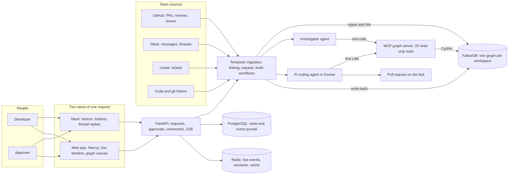
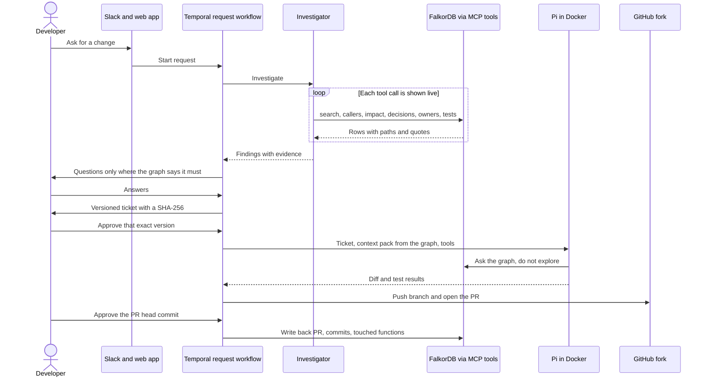
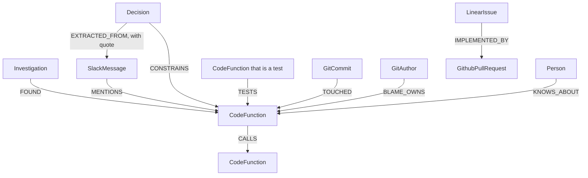
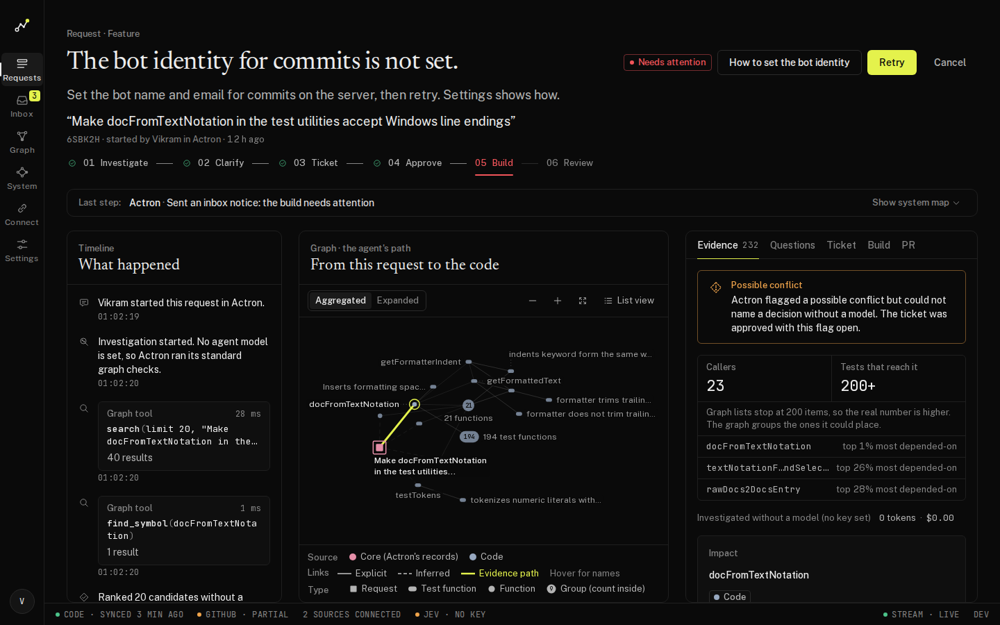
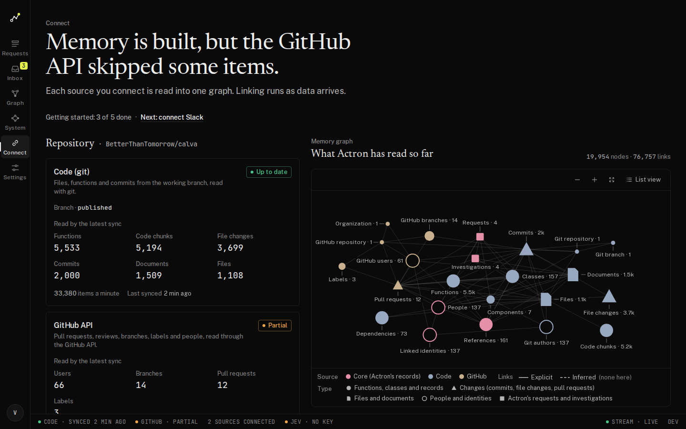
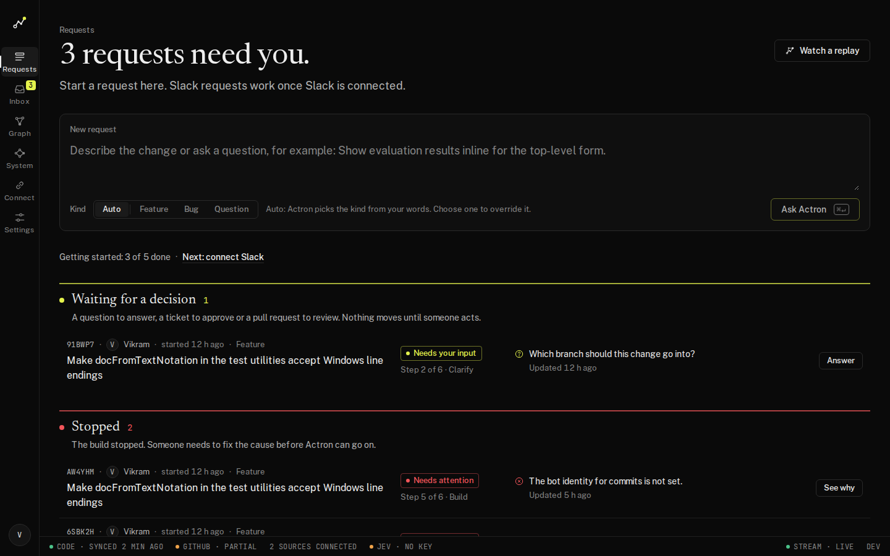

# Actron

**Actron checks what your team already decided and built before an AI writes code, then carries the change from a Slack request to a tested pull request, and shows the exact graph path behind every step.**

A developer gets a request in Slack. The reasons the software behaves as it does sit in Slack threads, PR reviews and Linear tickets; the dependencies sit in the code. A coding agent can satisfy the new request and break an earlier decision, or change a shared function and break something unrelated. Actron reads the code, git history, GitHub, Slack and Linear into one FalkorDB graph, walks that graph with an agent before anything is written, asks a person only when the graph says it must, and hands the evidence to the coding agent (Pi) in a sandboxed container. Every finding shows its source quote and the path through the graph that led to it.

Built for the FalkorDB Graph Hacks hackathon (WeMakeDevs, October 2026).

## The problem

Ask a coding agent to change one function and it will. What it cannot see is everything around that function:

- **Who depends on it.** On our demo repository, the request "make `docFromTextNotation` accept Windows line endings" touches a helper that 5 functions call and 964 tests exercise.
- **What the team decided.** The reason a helper must stay strict is in a Slack thread. The reason a function retries twice is in a review comment. The scope of a feature is in a ticket.
- **Who knows the code.** That lives in git history and blame, not in the file.

None of this is in the file the agent opens, and nothing connects it. So the agent can satisfy the new request and quietly break an old decision, or change a shared function and break something unrelated. Afterwards nobody can say why it did what it did.

### Why it needs to be solved

AI agents are moving from suggesting code to making changes and opening pull requests. A change that passes its tests but breaks a team decision costs a reverted PR, a bug found late, and trust in the agent. The check a careful engineer does before a change ("who calls this, did we decide something about it, who owns it, what did the ticket say") is exactly the check an agent skips. Actron does that check first, shows its evidence, and asks a person only when the evidence says it must.

### Why a graph is the right tool

The question Actron asks is never "which file matches this text". It is "what is connected to this, by what, and how strongly", across four kinds of source.

| What Actron has to answer | Why a flat store or vector search is not enough | What the graph does |
|---|---|---|
| Which tests and callers break if this function changes? | Needs repeated hops over `CALLS` and `TESTS`, not similar text | Backwards traversal over the call graph, one hop at a time |
| Which team decision constrains this code, and where was it said? | The decision, the Slack message and the function are different record types | `Decision -[CONSTRAINS]-> CodeFunction` and `Decision -[EXTRACTED_FROM]-> SlackMessage`, with the exact quote on the link |
| How risky is this function to touch? | A property of the whole network, not of the row | PageRank over `CALLS`, stored with a percentile |
| How are this Slack message and that function connected? | The answer is a path, and the path is the explanation | `algo.SPpaths`, drawn hop by hop in the UI as the evidence path |
| Who owns it, who knows it? | Needs commits, blame and CODEOWNERS joined to people | `TOUCHED`, `BLAME_OWNS`, `KNOWS_ABOUT` to `Person` |

The explanation of an answer is the path through the graph. That is why every finding in Actron shows its path and its source quote.

### How FalkorDB helped

FalkorDB is the only store the agent reasons over. If you take it away, the central question above cannot be answered, so the graph is not decoration.

- **One graph holds all four sources.** 96 node types from five ontology files, linked across sources (Slack message to decision to function to commit). Calva in our demo is 19,952 nodes and 76,532 links, including 5,533 functions, 11,754 `CALLS` and 4,150 `TESTS` links.
- **Graph algorithms are the agent's tools.** The investigator and the coding agent call 20 read-only tools over MCP. `criticality` is `algo.pageRank`, `shortest_path` is `algo.SPpaths`, `callers` and `impact` are variable-length traversals. Which tool the agent picks, and what it returns, is visible on the timeline.
- **Fast enough to use live.** A single shared query on hub functions (900+ callers) answers in 0.18 to 0.5 s. Under a 60-second load test (8 readers and 2 writers, the 50 most-called functions as seeds) there were 0 errors, shared query p95 1.7 s, impact p95 0.7 s, and 4,609 node writes a second.
- **One graph per workspace** keeps teams isolated (isolation is tested).
- **Honest about the limits.** We kept a log of every FalkorDB limit we hit, with the error text and the workaround: `algo.BFS` follows outgoing links only, `shortestPath` is directed and only allowed in `WITH` and `RETURN`, a planner trap that made a query 500 times slower until the lookup was anchored by id, and a crash replaying the append-only file after dropping a graph that had unique constraints. See [`docs/falkordb.md`](docs/falkordb.md).

## Architecture



How a request moves through it:



What the graph holds, in short:



Each link stores `method` (explicit, structural, extracted, inferred, confirmed) and a `confidence`. The full model is below under [The graph model](#the-graph-model).

## Tracks entered

- **Track 01: agents that act because of the graph** (main goal, every point implemented).
- Track 02 and Track 03 points that are real are listed below; nothing else is claimed.

| Track point | Where it is | Status |
|---|---|---|
| 01 Multi-hop reasoning | `shared_query` walks request → seeds → decisions, PRs, tickets → files → callers and tests in one composed query set, with the path to every item (`backend/actron/graph/queries.py`) | Done |
| 01 Graph queries and algorithms as agent tools | 20 read-only MCP tools: `callers` and `impact` (backwards traversal), `criticality` (PageRank via `algo.pageRank`), `shortest_path` (`algo.SPpaths`), `decisions_for`, `related_work`, `history`, `get_code` … (`backend/actron/mcp_graph/`) | Done |
| 01 Tool selection through MCP | The investigator agent and Pi both call the MCP server; every call is an event on the timeline and a pulse on the system map | Done (agent loop tested with a scripted model; live model needs a key) |
| 01 Actions based on the graph | Graph findings decide whether to ask a question (conflicts, criticality), scope the ticket (affected functions, constraints, test plan) and the build's context pack | Done |
| 01 Explainable results | Every evidence card has a quote, a source link, a confidence tier and "show path" | Done |
| 02 Episodic memory | Event journal per request (PostgreSQL), replay mode | Done |
| 02 Shared state and handoff | `handoff.created`: the investigation hands its evidence to the build through the graph (`FOUND`, `HANDED_TO`) | Done |
| 02 Memory per tenant | One FalkorDB graph per workspace, isolation tested | Done |
| 02 High concurrency | `scripts/load_test.py`: 8 readers + 2 writers, 0 errors (numbers below) | Done |
| 02 Procedural memory | `Procedure` nodes from merged PRs and CI files, used in `TASK.md` | Done (needs real PR history to learn from) |
| 03 Docs, tickets, chats, code in one graph | `CodeDocument`, `LinearIssue`, `SlackMessage`, `GithubPullRequest` in the same graph as `CodeFunction` | Done |
| 03 Who owns and who knows | CODEOWNERS, blame ownership, `KNOWS_ABOUT` scores | Done |
| 03 Decisions traced to source | `Decision` → exact quote → message, comment or ticket | Done (decision extraction needs a model key to run on new text) |
| 03 Knowledge kept current | Incremental sync on Temporal Schedules, webhooks, merge watch, freshness gate before every investigation and build | Done |
| 03 Answers with sources | Q&A mode (`/actron ask …`) | Done (answers are template-written without a model key) |

## How it works

The diagrams above show the parts and the order of a request. In steps:

1. **Ask.** `/actron make docFromTextNotation accept Windows line endings` in Slack, or the request box in the app.
2. **Investigate.** The investigator agent chooses graph tools over MCP (search, callers, impact, decisions, related work, owners, tests). Without a model key, a deterministic pipeline runs the same graph queries. Every call appears live on the timeline and the canvas.
3. **Decide.** If the graph shows a conflicting decision or a highly critical function, Actron asks 1–3 questions tied to the evidence, plus which branch to target. Answer in Slack or the app.
4. **Approve.** The ticket is canonical JSON with a SHA-256; approval is bound to that hash. A stale approval is refused, from either surface.
5. **Build.** Pi runs in a container with the ticket, a context pack built from the graph (`code.md`: source of every affected function, its callers, tests, decisions) and the MCP tools. Tests run in a second container with no network. Weakened tests and scope creep stop the build.
6. **Review.** PR approval is bound to the head commit. Write-back puts the PR, commits and touched functions into the graph.

Details: [`docs/architecture.md`](docs/architecture.md), [`docs/workflow.md`](docs/workflow.md), [`docs/agents.md`](docs/agents.md).

## The graph model

Five ontology files in [`ontology/`](ontology/) define every node type, property and relationship; nothing is created at runtime. 96 node types; `core.json`'s 54 relationships expand to 275 concrete links through node groups.

| File | What it models |
|---|---|
| `code.json` | repository, files, functions, classes, chunks (every line covered), documents, dependencies, CODEOWNERS, commits, authors, `CALLS`, `TESTS`, `TOUCHED`, `BLAME_OWNS`, `RENAMED_TO` |
| `github.json` | pull requests, files, reviews, review comments, issues, checks, workflow runs |
| `slack.json`, `linear.json` | messages (with versions and tombstones), channels, users; issues, comments, states |
| `core.json` | `Person`, `Identity`, `Reference`, `Decision`, `Feature`, `Procedure`, `Request`, `Investigation`, `BuildRun` and the links between sources: `MENTIONS`, `CONSTRAINS`, `EXTRACTED_FROM`, `IMPLEMENTED_BY`, `KNOWS_ABOUT`, `FOUND` |

Every link stores `method` (explicit, structural, extracted, inferred, confirmed) and `confidence`. The full generated model with every property: [`docs/graph-model.md`](docs/graph-model.md).

Real data in the demo graph (BetterThanTomorrow/calva at `b2476a7`, MIT): 19,952 nodes and 76,532 links, including 5,533 functions, 157 classes, 11,754 `CALLS`, 4,150 `TESTS`, 2,000 commits and 5,436 `TOUCHED` links. Every line of all 876 stored text files is covered by a function, class, chunk or document node.

## Key Cypher queries and algorithms

All in [`backend/actron/graph/queries.py`](backend/actron/graph/queries.py), explained with example output in [`docs/queries.md`](docs/queries.md).

**Who would break if this changes (impact), one hop per query over a deduplicated frontier:**
```cypher
UNWIND $ids AS fid
MATCH (x:CodeFunction {id: fid}) WITH x, fid
MATCH (x)<-[r:CALLS|INSTANTIATES]-(c:CodeFunction)
WHERE coalesce(c.deleted, false) = false
RETURN fid, c.id AS id, c.isTest AS isTest, r.confidence AS conf, r.callSiteLines AS lines
```

**Which team decisions constrain this code, with the exact quote and where it was said:**
```cypher
UNWIND $tids AS tid
MATCH (t:CodeFunction {id: tid}) WITH * MATCH (t)<-[c:CONSTRAINS]-(d:Decision)
WHERE coalesce(c.active, true) = true AND d.status IN $statuses
OPTIONAL MATCH (d)-[e:EXTRACTED_FROM]->(src)
OPTIONAL MATCH (d)-[:APPROVED_IN]->(ap)
RETURN tid, d, e.quote AS quote, src, collect(DISTINCT ap.id) AS approved
```

**Criticality: PageRank over the call graph** (stored on every function with a percentile):
```cypher
CALL algo.pageRank('CodeFunction', 'CALLS') YIELD node, score
```

**How are two things connected** (undirected; Cypher `shortestPath` is directed-only in FalkorDB):
```cypher
MATCH (a:SlackMessage {id: $a}), (b:CodeFunction {id: $b})
CALL algo.SPpaths({sourceNode: a, targetNode: b, relDirection: 'both', maxLen: 6}) YIELD path
RETURN path
```

Every FalkorDB limitation we hit, with the error text and the workaround, is in [`docs/falkordb.md`](docs/falkordb.md) (17 entries).

## Setup

Requirements: Docker with compose, [uv](https://docs.astral.sh/uv/), Node 22.19+.

```bash
cp .env.example .env            # every value may stay empty: features run as labelled stubs
uv run --project backend python -c "from cryptography.fernet import Fernet; print(Fernet.generate_key().decode())"
                                # paste into ACTRON_SECRET_KEY; set SESSION_SECRET to any long random string
make up                         # FalkorDB, PostgreSQL, Redis, Temporal + UI, backend, worker, frontend, backup;
                                # also builds the actron-pi and actron-test-runner images
open http://localhost:3000      # Dev login (ACTRON_ENV=dev), then Connect → Repository
```

Ingest a repository from the command line instead: `uv run --project backend actron ingest code --repo BetterThanTomorrow/calva --ws dev`.

What each key unlocks (all optional; missing keys show "not connected" or a `stub` badge, never a crash):

| Variable | Unlocks |
|---|---|
| `GITHUB_TOKEN`, `GITHUB_REPOSITORY`, `GITHUB_FORK` | full PR and review history (the public limit is 60 calls an hour), pushing build branches, opening PRs |
| `SLACK_*` | Slack ingestion, the bot, Sign in with Slack, "Add to Slack" (manifests in `infra/slack/`) |
| `LINEAR_API_KEY`, `LINEAR_TEAM_ID` | Linear ingestion and ticket sync |
| `TYPESAFE_API_KEY` | Jev judgments (classification, link checks, conflict probability, ranking) |
| `ANTHROPIC_API_KEY` (or OpenRouter, Gemini, Groq) and `MODEL_*` | the investigator agent, question and ticket writing, Pi |
| `ACTRON_BOT_NAME`, `ACTRON_BOT_EMAIL` | commits by the build |

Full list and operations: [`docs/runbook.md`](docs/runbook.md). Production: `make deploy` with `infra/compose.prod.yaml` (Caddy with automatic HTTPS, SSE-safe proxying, nightly `pg_dump` backups).

## Tests

```bash
make up-deps && make test      # backend and frontend suites
./scripts/test_all.sh          # everything, including spec coverage and Lighthouse
```

Backend: 1,400+ tests (unit, property-based, integration against real FalkorDB/PostgreSQL/Redis/Temporal, contract tests with fake Slack, GitHub, Linear, Jev and LLM servers, workflow tests in Temporal's time-skipping environment, build tests with a fake Pi in Docker), 88% line coverage. Every acceptance criterion in [`specs/`](specs/) is referenced by at least one test (`python3 scripts/spec_coverage.py`). Counts and how to run each level: [`docs/testing.md`](docs/testing.md); final numbers in [`BUILD-REPORT.md`](BUILD-REPORT.md).

Load test on the Calva graph (`scripts/load_test.py`, 60 s, 8 reader and 2 writer processes, the 50 most-called functions as seeds): 0 errors; shared query p95 1.7 s, impact p95 0.7 s, callers p95 0.4 s; 4,609 node writes a second.

## Screenshots

From the running app on real Calva data (no fixtures), captured with `frontend/scripts/capture-real.ts` at 1440 and 1920 px in [`frontend/tests/screenshots/real/`](frontend/tests/screenshots/real/):





Every screen and state (including the full request lifecycle, which needs provider keys to run live) is also captured from the development-fixture build in [`frontend/tests/screenshots/`](frontend/tests/screenshots/); those show a DEV FIXTURES badge.

## Limits

- Live integrations need keys. Everything is tested against fakes as well. What ran live: the real Calva clone and ingestion, GitHub's API, Slack (Socket Mode, the `/actron` command, mentions, buttons), Linear (queries), Jev, the investigator and writing models (DeepSeek), FalkorDB, PostgreSQL, Redis and Temporal. A request on real data ran through investigation, questions, ticket and approval. A full Pi build through to a pull request is the part still being verified live; see [`NEEDS-FROM-USER.md`](NEEDS-FROM-USER.md).
- Without model keys, judgments are conservative stubs: approved decisions touching a request show as "possible conflict", never "conflict", and the investigator uses the deterministic pipeline.
- 1,575 of Calva's TypeScript calls stay unresolved (method names shared by several classes need type information).
- The app is designed for screens 1,024 px and wider; approvals also work in Slack.

## Timeline

- This repository was created on 17 October 2026.
- The product requirements, ontology and specs were written on 17 October.
- The build ran from 17 October (first entry in [`BUILD-LOG.md`](BUILD-LOG.md), 17:20) to 18 October (last entry).
- The first two commits in the history are an earlier prototype that this project builds on and does not reuse.

## AI use disclosure

We used an AI coding assistant (Claude Code, from Anthropic) to implement this project. How the work was split:

- **The team designed it:** the problem, the product, the architecture, the ontology (which node types and links exist), and the specs with their acceptance criteria.
- **The assistant implemented** those specs, with every acceptance criterion tied to at least one test.
- **The team reviewed and verified it:** reading the graph model and queries, running the app against real services (Slack, Linear, GitHub, the model and Jev), debugging what broke, and judging the UI.

The team can explain the graph model, the queries, the architecture and the decisions above. At runtime Actron itself uses TypeSafe Jev for judgments, an LLM through LiteLLM for text, and Pi as the coding agent.

## License

Actron is open source under the [MIT License](LICENSE). Calva (used as the demo repository) is MIT licensed by its authors and is not included in this repository. Third-party libraries keep their own licenses. Brand marks belong to their owners (see `frontend/public/brands/LICENSES.md`).
