# Run Actron on your own computer

This guide takes you from nothing to a working Actron on your own computer. You do not need to be a developer. You will copy and paste commands and click through the app.

Actron is a tool for engineering teams. You ask for a change in Slack or in the web app. Actron checks what your team already knows (code, GitHub, Slack and Linear), asks you questions, writes a ticket, builds the change with a coding agent, and opens a pull request for you to review.

At the end of this guide you will have the full app running at `http://localhost:3000`, your own sources connected, and your first request done.

**How long it takes.** About 15 to 40 minutes the first time, mostly waiting. This is an estimate. The first start builds several Docker images (the app, the web screen, the coding agent and the test runner) and downloads the databases. A fast machine and fast internet are at the low end. Later starts take about a minute. Connecting sources and the first sync add 5 to 15 minutes more, depending on repository size.

**What was checked.** Each section says what was checked against the running app. A full clean install from an empty computer was not run for this guide. The commands and the on-screen words were checked against the project files and the app that is running on a Linux machine.

---

## 1. What you need

| You need | Details |
|---|---|
| A computer | 4 CPU cores and 8 GB of memory are recommended (from `docs/runbook.md`). Less may work but will be slow. |
| Disk space | About 15 GB free for Docker images, databases and builds. This is an estimate. |
| Operating system | Linux: checked (the app runs on Linux). macOS: not checked. Windows: use WSL2 (Ubuntu inside Windows). Not checked. |
| Docker | Docker Engine with the "compose" plugin. On macOS and Windows install Docker Desktop. |
| git | To download the code. |
| make and curl | `make up` is a make command, and the health check uses curl. Most Linux machines have them. On Ubuntu or WSL: `sudo apt install make curl`. |
| python3 or openssl | Only used by the small setup script in step 3. Almost every machine has one. |
| Free ports | 3000 (the app), 8080 (the API), 8233 (Temporal screen), 5433, 6380, 6389 and 7233 (databases and workflow engine). |

You do **not** need Node.js or `uv` on your computer. Everything runs inside Docker. (They are only needed if you want to run the tests.)

Check Docker works. Run:

```bash
docker --version
docker compose version
docker run --rm hello-world
```

You should see two version lines and then "Hello from Docker!". If `docker run` says "permission denied" on Linux, run `sudo usermod -aG docker $USER`, log out, log in and try again. If it says it cannot connect to the Docker daemon, start Docker (open Docker Desktop, or `sudo systemctl start docker`).

If you use Windows with WSL2: install Docker Desktop, turn on "Use the WSL 2 based engine" and WSL integration for your Ubuntu, then do everything below inside the Ubuntu terminal. Put the code in your Linux home folder (`~`), not under `/mnt/c`. This path was not tested.

If you use macOS: the build folder in step 3 needs one extra setting (see the note there). This path was not tested.

---

## 2. Get the code

```bash
git clone https://github.com/malikanubhav/actron.git
cd actron
git checkout prod
```

`prod` is the branch that was submitted. You should now be in a folder called `actron` that contains `README.md` and `Makefile`.

---

## 3. Create the settings file

Actron reads its settings from a file called `.env`. A helper script creates it and fills the two secret values for you. Run:

```bash
bash scripts/setup-local.sh
```

You should see lines like "Created .env from .env.example." and "ACTRON_SECRET_KEY was empty. Filled it with a new random value." The script never prints the secrets and never overwrites a value you already set. It is safe to run again.

What the two values do: `ACTRON_SECRET_KEY` encrypts the tokens you paste into the app. `SESSION_SECRET` keeps your browser sign-in safe. Keep `.env` private and do not share it. Do not lose `ACTRON_SECRET_KEY`: without it Actron cannot read the tokens it saved, and you would have to connect your sources again.

Every other value can stay empty for now. Empty means "not connected" or "stub", never a crash.

**macOS only.** Open `.env` in a text editor, find `ACTRON_BUILD_HOST_DIR=/var/lib/actron/builds` and change it to a folder inside your home folder, for example `ACTRON_BUILD_HOST_DIR=/Users/yourname/actron-builds`. Docker Desktop shares your home folder by default but not `/var/lib`. Not tested.

---

## 4. Start Actron

```bash
make up
```

This builds and starts everything. It takes a long time the first time (see the estimate above). Wait until it ends with a line of JSON that contains `"falkordb":"ok","postgres":"ok","redis":"ok","temporal":"ok"`. The `integrations` part will say `stub` or `not_connected` for things you have not set up yet. That is normal.

If `make up` stops with an error, see the troubleshooting table in section 11. You can run `make up` again: it continues where it stopped.

Open the app: **http://localhost:3000**. You should see the Actron landing page with the heading "Your AI doesn't know what your team already decided. Actron does." You can also check the health yourself at `http://127.0.0.1:8080/api/health`.

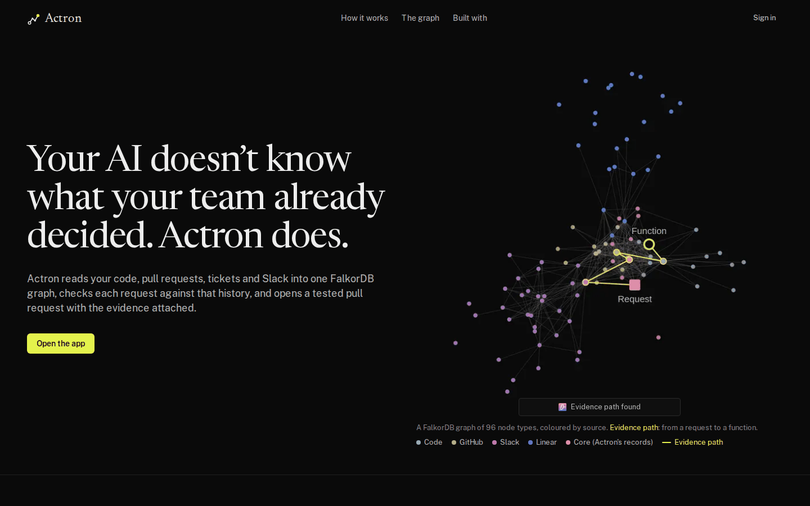

Everyday commands (run them in the `actron` folder):

| What you want | Command |
|---|---|
| Stop Actron (your data stays) | `make down` |
| Start it again | `make up` |
| See what it is doing | `make logs` (press Ctrl+C to leave) |
| Logs of one part | `docker compose -f infra/compose.yaml logs -f --tail=100 backend` |
| Check health | `make health` |
| Wipe everything and start fresh | `docker compose -f infra/compose.yaml down -v` (deletes all data, see section 10) |

---

## 5. Sign in the first time

Click **Open the app** (or go to `http://localhost:3000/app/signin`). You will see two buttons: **Sign in with Slack** and **Dev login** (with a small "Dev only" label).

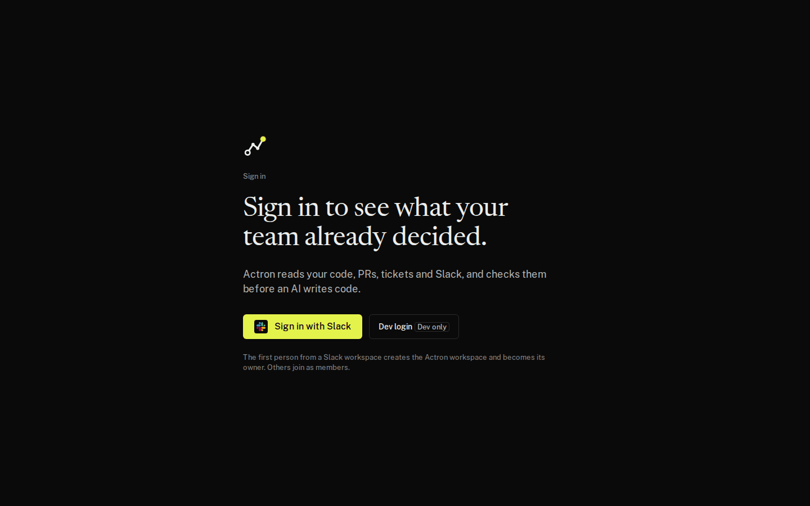

**On your own computer, click Dev login.**

Why: "Sign in with Slack" needs a public web address (`https://...`) so Slack can send you back to Actron after you sign in. A laptop does not have one. "Dev login" is the local sign-in for this reason. It works only because `ACTRON_ENV` is not set to `prod` in your `.env`. It is not a limited demo: everything after sign-in is the real product. The first person to sign in becomes the owner of the workspace, so you can approve things.

You should land on the Home screen with a box that says "Describe the change or ask a question".

### Optional: sign in with Slack instead

You only need this if you want to sign in with your real Slack identity. Skip it if Dev login is enough. Slack must be able to reach your computer over HTTPS. Not tested end to end for this guide on a clean install. The Slack redirect and tunnel steps below were not run here.

1. Get a public HTTPS address that points to port 3000 on your computer. One way: in VS Code, open the Ports tab, forward port 3000, right-click it and set Visibility to Public. Any tunnel tool that gives you an `https://` address works too. Call it `<address>` below.
2. In your `.env` set `ACTRON_PUBLIC_URL=<address>` (no slash at the end).
3. In your Slack app (api.slack.com/apps, your app), open Basic Information and copy the Client ID and Client Secret into `.env` as `SLACK_CLIENT_ID` and `SLACK_CLIENT_SECRET`.
4. In the Slack app, open OAuth & Permissions, Redirect URLs, and add both:
   - `<address>/api/auth/slack/callback`
   - `<address>/api/slack/oauth/callback`
5. Reload the settings (this is needed after every `.env` change, see section 8): `docker compose -f infra/compose.yaml up -d --force-recreate backend worker`
6. Open `<address>/app/signin` and click **Sign in with Slack**.

---

## 6. Connect your sources (all done inside the app)

Open **Connect** in the left bar. Each source has a card. Every card has a **Set up step by step** button. It opens a guide on the right that explains every click and checks each step for you ("Done" or "Not yet"). Paste tokens only into the form on the card.

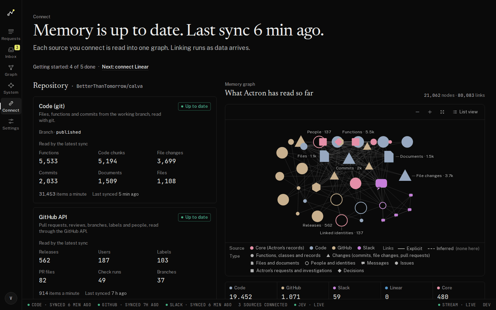

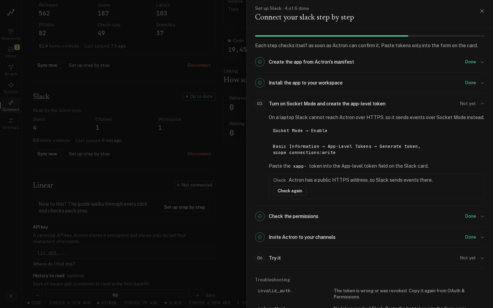

Every form works the same way: fill in the fields, press **Check connection** (Actron makes one test call and saves nothing yet), then press **Connect**. Secrets are stored encrypted. Afterwards the app shows only the last four characters.

The screenshots in this guide come from an app where GitHub and Slack are already connected, so the empty forms were not on screen. The form field names below come from the app's own form definition (`backend/actron/connectors/forms.json`) and the guide texts (`frontend/content/guides/`), which the app shows.

### 6.1 GitHub (code, pull requests, reviews)

Use a fork if you do not have write access to the repository you want to try. Actron opens its pull requests on the repository in "Push to", never on an upstream repository.

1. If you want to try Actron on someone else's repository, fork it on GitHub first (the Fork button).
2. Open the **Set up step by step** guide on the GitHub card and click **Open GitHub token creation**. Create a fine-grained token: Token name `Actron`, Repository access "Only select repositories" (choose the repository and the fork you push to), then these permissions:

   | Permission | Level |
   |---|---|
   | Contents | Read and write |
   | Pull requests | Read and write |
   | Issues | Read |
   | Metadata | Read |
   | Actions | Read |
   | Checks | Read |

3. Copy the token (it starts with `github_pat_`). GitHub shows it only once.
4. On the GitHub card fill in: **Access token** (paste), **Repository** (`owner/name`, for example `BetterThanTomorrow/calva`), **Working branch** (pick from the list, usually the default branch), and **Push to** (your fork as `owner/name`; leave empty to use the repository above). **Upstream (history only)** and **History to read** (default 90 days) are optional.
5. Press **Check connection**, then **Connect**. Saving creates the "Code (git)" and "GitHub API" connections together.

Without a token GitHub allows only 60 calls an hour, so a large repository will not finish. Use a token.

**Webhook (optional).** A webhook makes new merges reach Actron immediately. Without it Actron checks GitHub every 5 minutes, which is fine. A webhook needs a public HTTPS address, so skip it on a laptop. The guide's last step ("Add the webhook for instant updates") is marked Optional.

### 6.2 Slack (the conversation and the bot)

You create a small Slack app that is Actron's bot. Do this in a Slack workspace where you may add apps.

1. In the Slack guide on the Slack card, step 1 shows the manifest (a text file that sets the bot's name, permissions and `/actron` command). Use **Copy manifest**, or open `infra/slack/manifest.dev.yaml` in the code. Nothing needs replacing in it.
2. Go to api.slack.com/apps. Click **Create New App**, then **From an app manifest**, choose your workspace, paste the manifest and click **Create**.
3. Click **Install App**, then **Install to Workspace**, then **Allow**.
4. Open **OAuth & Permissions** and copy the **Bot User OAuth Token** (starts with `xoxb-`).
5. Open **Basic Information** and copy the **Signing Secret**. (Only needed if you use the HTTPS path. Keep it for later.)
6. In the app, turn on **Socket Mode** (Socket Mode, Enable). On a laptop Slack cannot call Actron over HTTPS, so it sends events through Socket Mode. Then go to **Basic Information, App-Level Tokens, Generate token**, give it the scope `connections:write`, and copy the token (starts with `xapp-`).
7. In Actron's Slack card choose the **Connect with tokens** path. Paste the **Bot token** (`xoxb-`) and the **App-level token** (`xapp-`).
8. In Slack, go to each channel Actron should read and type `/invite @actron-dev` (the bot's display name in `infra/slack/manifest.dev.yaml` is `actron-dev`; the app's guide copies `/invite @Actron`, so use the bot name that Slack shows if you changed it). **Actron reads only channels the bot has joined.**
9. Back in Actron, pick the channels in **Channels to read**. Choose **Where people ask Actron** if you want updates in one channel. Press **Check connection**, then **Connect**.
10. In any channel the bot is in, type `/actron hello`. The guide's last step ("Try it") turns green when Actron answers.

**Warning: do not turn on token rotation** in the Slack app. Actron stores the token you paste and cannot refresh a rotating token. Rotating tokens would stop working after a short time.

If Slack shows "app did not respond" when you use `/actron`, the backend has not loaded your settings or is not running. See section 11.

### 6.3 Linear (tickets), optional

1. In the Linear guide click **Open Linear security settings**, then Personal API keys, **New key**, name it `Actron`, **Create**. Copy the key (starts with `lin_api_`).
2. On the Linear card paste it into **API key**, press **Check connection**. Actron shows your name and organisation.
3. Choose the **Team** whose issues Actron reads and where it creates tickets. Optionally set **Label for Actron's tickets** and **History to read**. Press **Connect**.

Linear is optional. Without it, Actron still works, but tickets are not synced to Linear.

### 6.4 What happens after you connect

Actron starts a first sync (the code, then GitHub and Slack history). The Connect screen shows the counts rising and the heading changes to "Memory is up to date". On the project's real test repository the code part took about 2 minutes and GitHub history longer. Larger repositories take longer. You can already use Actron while it finishes, but answers get better when the sync is done.

---

## 7. Model and Jev keys (the one thing done outside the app)

> **This is the one thing done outside the app.** The app shows which model runs each job (Settings, Models) but you cannot type the keys there. The keys go into your `.env` file.

Actron uses two kinds of AI: Jev (from TypeSafe) for quick yes/no and scoring judgments, and a language model for text and for the investigator and coding agent. The working setup used in this project is DeepSeek models with Jev.

Open `.env` in a text editor and fill in what you have:

| Variable | What it unlocks |
|---|---|
| `TYPESAFE_API_KEY` | Jev judgments (classification, conflict checks, link checks). |
| `DEEPSEEK_API_KEY` | The language models used in this project (the `MODEL_*` names default to DeepSeek models). |
| `GEMINI_API_KEY` | Optional fallback model. The free Gemini tier allows only 20 requests a day per model. |
| `ANTHROPIC_API_KEY`, `OPENROUTER_API_KEY`, `GROQ_API_KEY` | Other providers, if you prefer them. |
| `MODEL_DECISION`, `MODEL_WRITING`, `MODEL_AGENT`, `MODEL_CODING` | Which model does which job. The names are in `.env.example`. A model counts as available only if its provider key is set. |

More detail: `.env.example` and `docs/models-and-jev.md`.

**After you change `.env`, a plain restart does not load it.** Run:

```bash
docker compose -f infra/compose.yaml up -d --force-recreate backend worker
```

Then run `make health`. The `integrations` part should show `live` for the ones you set.

**What happens without keys.** Nothing crashes. Features show a `stub` badge or "not connected". The investigation still runs: a fixed pipeline asks the graph the same questions (callers, tests, decisions, owners), so you still get evidence. Questions and tickets are written from templates and marked as stubs. The coding agent cannot build without a model key, so no pull request is made without one.

**Other settings** (in the app: **Settings**):

- **Bot name for commits** and **Bot email for commits** (section "Bot identity"): who Actron's commits come from. Use an address your repository accepts. They can also be set in `.env` as `ACTRON_BOT_NAME` and `ACTRON_BOT_EMAIL`. If they are empty, a build stops and the Inbox shows "The bot identity for commits is not set." Set them before your first build.
- **Approvers** (section "People"): see section 9.
- **Daily budget for model use** is only in `.env`: `ACTRON_DAILY_MODEL_BUDGET_USD` (default 20). It counts the investigator and writing calls, not the coding agent's cost.

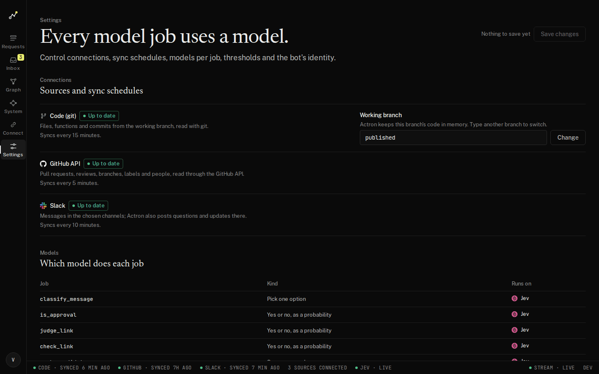

---

## 8. Your first request

1. Open **Requests** (Home). Type what you want in the box, for example: `make docFromTextNotation accept Windows line endings` (this is the example from the demo repository; use something real for yours). Press **Ask Actron**. You can choose a kind (Auto, Feature, Bug, Question) or leave it on Auto.
   Or in Slack, in a channel the bot has joined, type `/actron <your request>` or `@actron <your request>`.
2. Watch the request page. The timeline shows each graph question Actron asks. The graph in the middle draws the path from your request to the code. The right side has the tabs Evidence, Questions, Ticket, Build and PR.

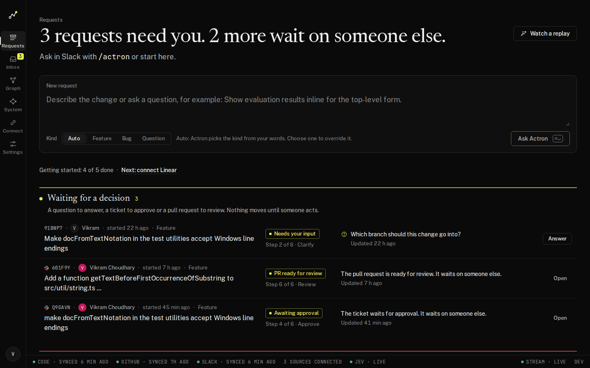

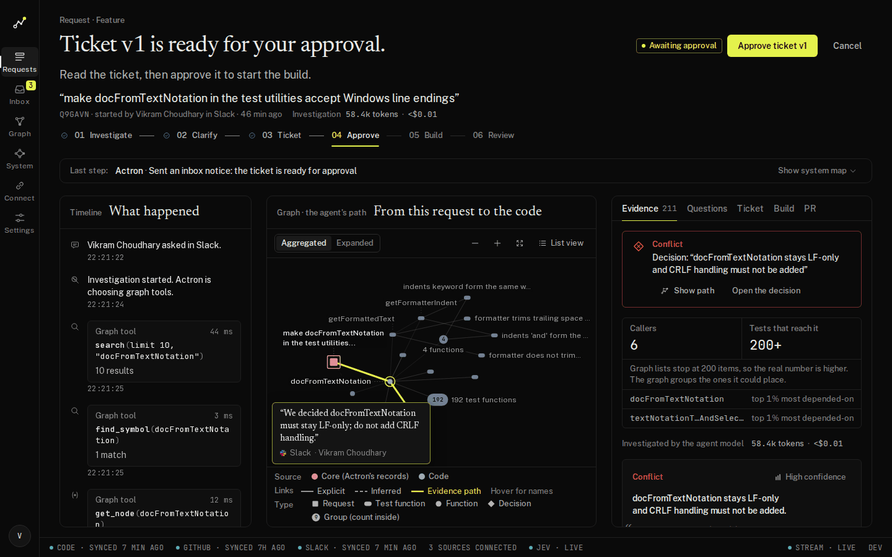

What the states mean:

| State | What it means | What you do |
|---|---|---|
| Investigating | Actron is reading the graph. | Wait. |
| Needs your input | The graph shows something a person must decide (for example an earlier decision that conflicts). Actron asks 1 to 3 questions, plus which branch to target. | Answer. |
| Ticket ready | Actron wrote the ticket. | Read it (Ticket tab). |
| Awaiting approval | The ticket waits for approval. | Approve it. |
| Building | The coding agent (Pi) is making the change in Docker and running tests. | Watch the Build tab. |
| PR ready for review | A pull request is open with test results. | Review and approve it. |
| Done | The pull request is approved and Actron recorded it in memory. | Merge it on GitHub if you want. |

**Answering questions.** In the Questions tab click an answer, or in Slack click the buttons in Actron's thread. For a text question reply in the thread starting with the question number, for example `2 only the helper`.

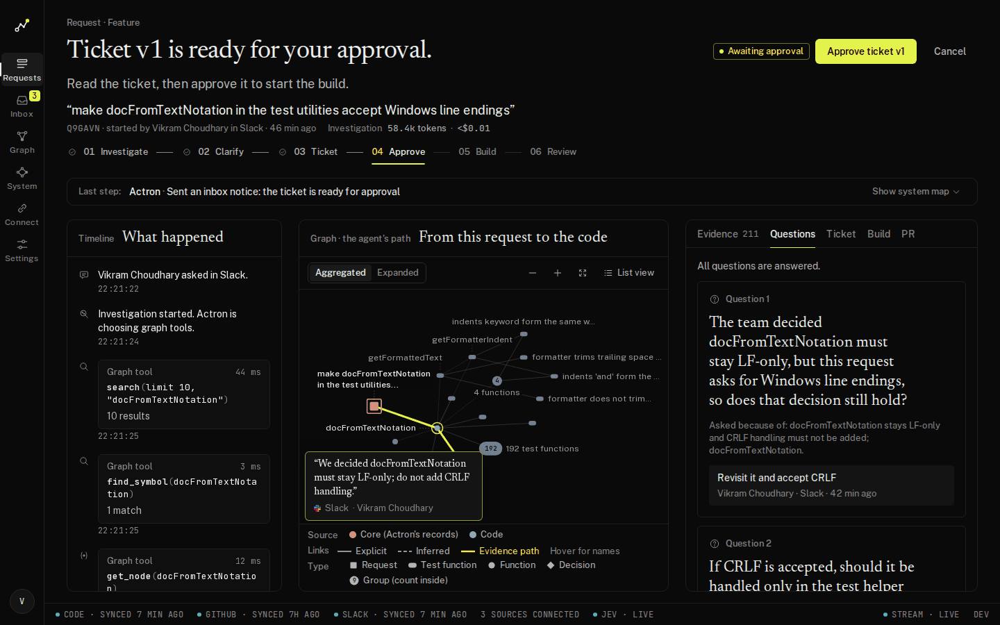

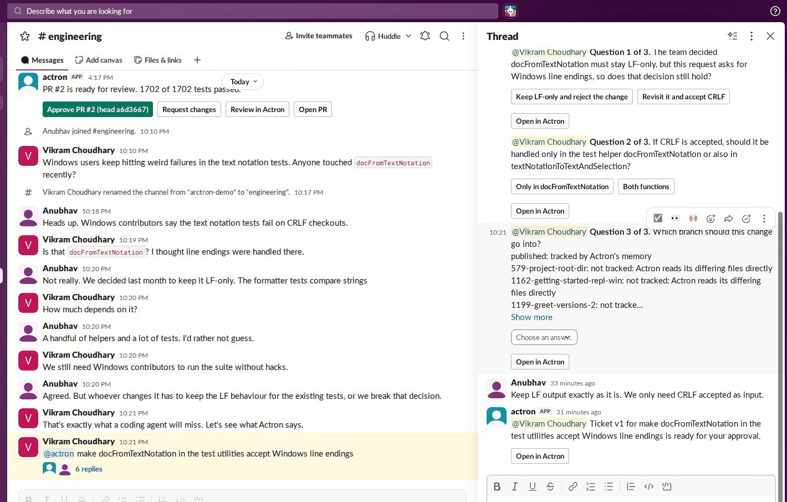

**Approving the ticket.** The ticket is versioned and has a fingerprint (a SHA-256 hash). Your approval is for that exact version. If someone edits the ticket, you must approve the new version. Press **Approve ticket v1** in the app or the button in Slack.

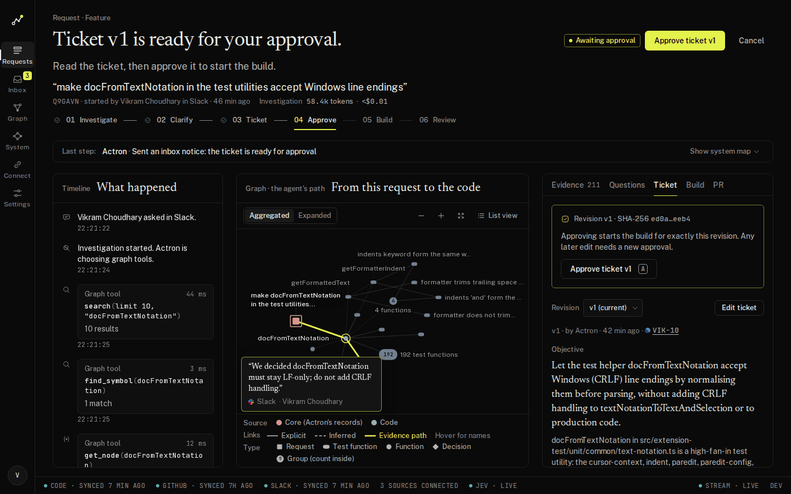

**Watching the build.** The Build tab lists each step Pi took, the tests that passed and failed, and any repair attempts. This takes a few minutes. The build runs in a Docker container with only a checkout of your code, and tests run in a second container without network.

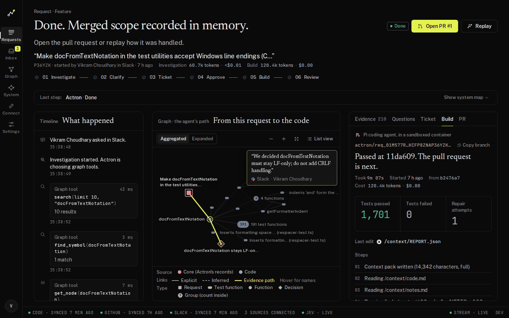

**Reviewing the pull request.** The PR tab shows the pull request, the constraints that must still hold (each with proof) and the approval. Open the pull request on GitHub to read the diff. Then press **Approve PR** (it is tied to that exact commit, so a later push needs a new approval), or **Request changes**, or **Close PR**. In Slack the message has Approve PR, Request changes, Review in Actron and Open PR.

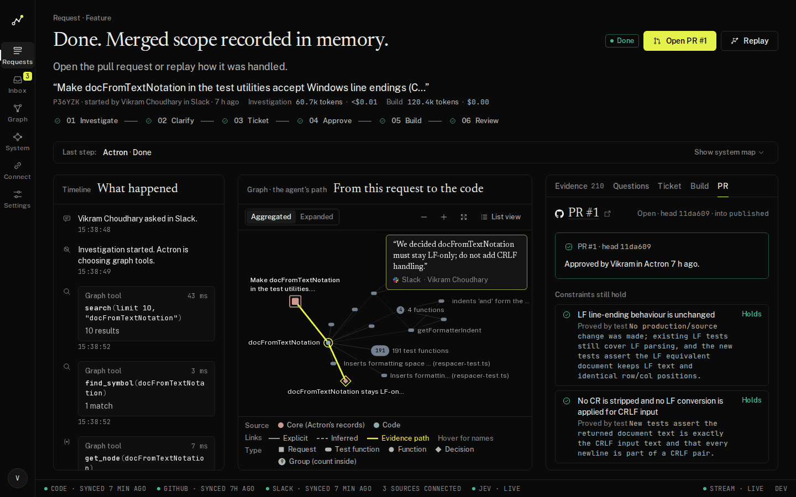

When you approve, Actron writes the pull request, its commits and the functions it touched back into the graph, so the next request knows about this change.

---

## 9. Who may approve

An approval is accepted from: the person who made the request (the requester), the workspace owner, or a Slack user on the approvers list.

- A request you start **in the app**: you are the requester. You can approve it.
- A request someone starts **in Slack**: the requester is that Slack person. In the app, the Dev login user is a different person. In a fresh install the Dev login user is the workspace owner, so it can approve (this was checked in the code, and the running app shows a Slack-started request approved by the Dev login user). If a click is refused, add the approver's Slack member ID: open **Settings**, section **People**, field **Approvers** ("Slack user ids allowed to approve, besides the requester and the owner") and press **Save changes**. To find a Slack member ID: open the person's profile in Slack, click the three dots, **Copy member ID**.
- In Slack, the buttons check the same rules. A refused click answers only the person who clicked.

---

## 10. Where your data lives, backups, and wiping

Everything stays on your computer, in Docker volumes:

- The graph (FalkorDB), the app database (PostgreSQL: requests, tickets, encrypted connection secrets), live events and sessions (Redis), the workflow engine (Temporal), database backups, and the cloned repositories.
- Build folders are on your disk at `ACTRON_BUILD_HOST_DIR` (default `/var/lib/actron/builds`).
- The only data that leaves your machine is what you connect: calls to GitHub, Slack and Linear, and the text sent to the model and Jev providers for the keys you set.

Backups: a service makes a database dump once a day and keeps 7 days (see `docs/runbook.md`, "Backups and restore"). List them with `docker compose -f infra/compose.yaml exec backup ls -l /backups`. The graph can always be rebuilt by syncing again.

**To wipe everything** (this deletes all your data, requests and saved tokens):

```bash
docker compose -f infra/compose.yaml down -v
```

Then run `make up` for a clean start. If you also want to remove the build folders, delete the folder in `ACTRON_BUILD_HOST_DIR`. This wipe command was not run for this guide, because the stack that was running here is in use.

---

## 11. Troubleshooting

| What you see | What it means and what to do |
|---|---|
| `make: command not found` | Install make: `sudo apt install make` (Ubuntu or WSL). |
| `make up` says a port is already in use | Another program uses 3000, 8080, 8233, 5433, 6380, 6389 or 7233. Close it, or set another port in `.env` (for example `ACTRON_PORT`, `FRONTEND_PORT`, `FALKORDB_PORT`, `POSTGRES_PORT`, `REDIS_PORT`, `TEMPORAL_PORT`, `TEMPORAL_UI_PORT`). |
| "Cannot connect to the Docker daemon" | Docker is not running. Start Docker Desktop or `sudo systemctl start docker`. |
| `make up` is very slow | The first start builds images. This is normal. It can take 15 to 40 minutes. Run `make logs` in a second window to see progress. |
| `make up` fails with "unhealthy" | A part did not start in time (5 minutes limit). Run `make up` again. If it repeats, run `make logs` and look at the part named in the error. |
| `http://localhost:3000` does not load | Run `make health`. If it fails, run `docker compose -f infra/compose.yaml ps` to see which part is down, then `make logs`. |
| Health shows `error` for a store | That database is not running. `docker compose -f infra/compose.yaml ps` shows it. Run `make up` again. |
| No "Dev login" button | `ACTRON_ENV` is set to `prod` in `.env`. Set it to `dev` and recreate: `docker compose -f infra/compose.yaml up -d --force-recreate backend worker`. |
| Slack says "app did not respond" or the card says not connected | The backend did not load your new settings, or Socket Mode is off. Run `docker compose -f infra/compose.yaml up -d --force-recreate backend worker`. Then check the app-level token has `connections:write` and Socket Mode is enabled. |
| Actron does not see messages from a channel | The bot is not in the channel. Type `/invite @actron-dev` there (or your bot's name), then pick the channel in Connect. |
| Slack tokens stop working after a while | Token rotation is on in the Slack app. Turn it off and reinstall the app. |
| Notice "The bot identity for commits is not set." | Set **Bot name for commits** and **Bot email for commits** in Settings (or `ACTRON_BOT_NAME` and `ACTRON_BOT_EMAIL`). Then retry. |
| Model errors about quota (Gemini) | The free Gemini tier allows 20 requests a day per model. Use another provider as the main model or enable billing at Google. |
| Model errors about balance (DeepSeek) | The account has no credit. Add credit at DeepSeek or switch the `MODEL_*` names to another provider you have a key for. |
| The page shows `stub` badges | The key for that part is missing. See section 7. |
| GitHub sync stops, "rate_limit" | Without a token GitHub allows 60 calls an hour. Add the token on the GitHub card. Actron continues when GitHub's limit resets. |
| GitHub check says 401, 403 or 404 | 401: token wrong or expired. 403: a permission is missing (the check names it). 404: wrong repository name or the token has no access to it. |
| First sync is slow | Normal. Code takes a few minutes, GitHub and Slack history longer. Lower **History to read** (days) to make the first sync faster. |
| FalkorDB (the graph database) will not start after a restart | Do not restart FalkorDB by hand with `docker compose restart falkordb`, and never delete a graph by hand. A known problem in the graph database version used here can crash it on the second restart after a graph with unique constraints is deleted. Look at `docker logs` of the falkordb container for "crashed by signal". The recovery steps are in `docs/falkordb.md` (limitation 12). Stopping and starting with `make down` and `make up` is the normal way. |
| Changed `.env` but nothing changed | A plain restart does not reload `.env`. Run `docker compose -f infra/compose.yaml up -d --force-recreate backend worker`. |
| The build does not start | Check that you approved the ticket, that the model key for `MODEL_CODING` is set and that the bot identity is set. The Inbox shows why a build stopped. |

---

## 12. What you can do next

- Connect your own repository and ask for a real change.
- Open **Graph** and search for a function or a decision to see its callers, tests and where a decision was made.
- Open **Inbox** to see everything Actron needs from you in one list.
- Open **System** to see what Actron is doing right now.
- Add teammates as approvers in Settings.
- Watch a finished request again with **Replay** on the request page.
- Read `docs/workflow.md` and `docs/architecture.md` to see how a request moves through Actron.
- Run the test suites (this needs Node 22.19+ and `uv` on your computer): see `docs/testing.md`.

---

## What was verified for this guide

Verified against the running app on a Linux machine (the Connect screen, the GitHub, Slack and Linear cards and their "Set up step by step" guides, the Settings screen and the sign-in page were opened and their words copied): the button and label names, the guide steps, the permissions table for the GitHub token, the Slack guide steps, Settings fields (Approvers, Bot name for commits, Bot email for commits, thresholds), the Dev login button, the health address and the `make` targets and Docker compose file names. The setup script was tested in a temporary copy of the repository.

Not verified: a full clean install from an empty computer (the first-start time is an estimate), macOS, Windows with WSL2, Sign in with Slack through a public address, the Slack and GitHub forms on a brand new workspace (the running app has GitHub and Slack already connected, so those forms were taken from the app's form definition), the wipe command, and the Linear connection (Linear is not connected in the running app).
