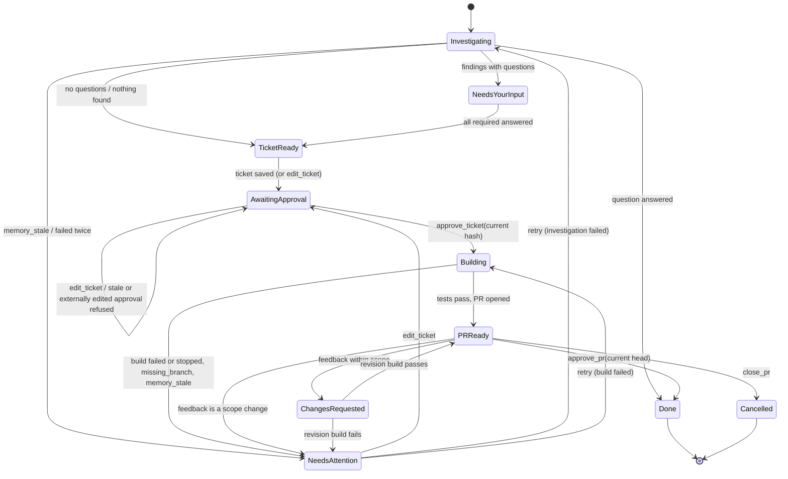
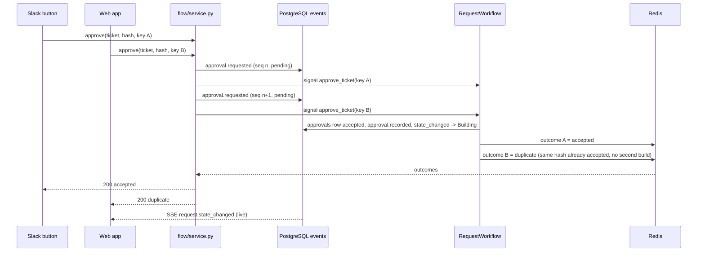

# Request flow

How a request moves from a Slack message or the web app to a merged pull request, and how Slack and the UI stay
in step. Spec: `specs/B-agents-and-workflow.md` (B.C1, B.C2, B1, B2, B6–B8, B10, B12a, B13). Code:
`backend/actron/flow/`, `backend/actron/workflows/{request,writeback}.py`, `backend/actron/activities/request.py`,
`backend/actron/api/`.

## The parts

| Part | File | Job |
|---|---|---|
| States and transitions | `flow/states.py` (+ `flow/states.json`) | The ten states, every allowed (state, action) pair as data, the signal table, chip colours and Slack labels |
| Service | `flow/service.py` | The only way to change a request: idempotency, member and approver checks, action event, signal, publish; the read model `get_request_view` |
| Journal | `flow/events.py` | `emit`: one PostgreSQL row with a gap-free `seq`, notifications, Redis publish, Slack sender; SSE replay |
| Workflow | `workflows/request.py` | `RequestWorkflow`: the authority on state; decides every outcome |
| Activities | `activities/request.py` | All I/O of the workflow: freshness gate, investigation, questions, tickets, Linear, approvals, build input, PR checks, write-back |
| Write-back | `workflows/writeback.py`, `flow/writeback.py` | Records the delivered PR, build and procedures in the graph |
| Notifications | `flow/notifications.py` | The four interrupting kinds only |
| Budget | `flow/budget.py` | Daily model spend against the cap |

## States

`Investigating` → `Needs your input` → `Ticket ready` → `Awaiting approval` → `Building` → `PR ready for review` →
`Done`. Also `Needs attention`, `Changes requested`, `Cancelled`. Questions (`kind = question`) go
`Investigating` → `Done` with outcome `answered`. The table in `flow/states.py` is PROMPT appendix F; the workflow
calls `transition(state, action)` before every change, so an action that is not in the table raises
`InvalidTransition` and is refused with `invalid_transition` in both surfaces.

Any non-final state also goes to `Cancelled` on `cancel`; a running build child (and its Pi activity) is
cancelled first.

## Who writes what

The service records what a person asked for; the workflow decides what happens.

1. **Service** (`service.answer`, `edit_ticket`, `approve`, `feedback`, `cancel`, `retry`, `close_pr`):
   - Idempotency: `SET idem:<ws>:<key> NX EX 86400` in Redis, with `idempotency_keys` in PostgreSQL as the backup
     and the fallback when Redis is down. A repeat returns the stored result, or the stored refusal.
   - The actor must be a member (403 `not_a_member`). Slack users are created on first contact and join the
     workspace. Approvals also need the requester, the owner, or a Slack id in `settings.approvers`
     (403 `not_an_approver`, with an `approval.refused` event and a refused `approvals` row).
   - Quick pre-check with the workflow's `state()` query (the `requests.state` mirror if Temporal does not answer
     within a second): an action not valid now is a 409 `invalid_transition` and writes nothing.
   - One transaction writes the action event (`answer.received`, `ticket.edit_requested`, `approval.requested`,
     `review.feedback`, `request.cancel_requested`, `request.retry_requested`, `pr.close_requested`) with the next
     `seq` and `signal_status = pending`. The payload keeps `signal` and `signalPayload` so it can be re-sent.
   - Signal the workflow (payload carries `actor` and `idempotencyKey`), then mark the event `sent`, then publish.
   - Approvals and ticket edits wait up to 3 seconds for the workflow's decision on Redis
     `outcome:<requestId>:<idempotencyKey>`: accepted → 200, refused → 409 with the reason, no answer → 202 (the
     page follows the stream).
2. **Workflow** dedupes signals by `idempotencyKey`, checks the action against its own state and data (current
   revision hash, current PR head from GitHub, Linear external edits), then calls activities that write the
   `approvals` row, the outcome events (`approval.recorded` / `approval.refused`, `request.state_changed`), the
   `requests.state` mirror and the `Request` node in the graph.
3. **Reconciler** (`service.reconcile_once`, every 30 s in the worker) re-sends signals that stayed `pending` and
   starts workflows that never started. The workflow ignores a key it has seen, so a re-send applies once.

## The workflow, step by step

1. `ensure_fresh`: compare `CodeRepository.headSha` with the working branch head (GitHub API, else
   `git ls-remote`). If the repository moved, emit `memory.refreshing`, trigger the code and GitHub schedules and
   poll the graph until it has the new head (10 minutes; then `Needs attention` with `memory_stale`). Unreachable →
   `memory.unverified` and continue. Before a build the target branch is checked too (`missing_branch`).
2. `investigate_request`: W5's investigator (agent or pipeline; pipeline with stubs when the daily budget is
   reached, with `budget.reached`). Two attempts; then `Needs attention`. Findings, evidence and the
   investigation summary are stored on the request.
3. Questions: questions are capped at three and tied to evidence in the findings. Feature and bug requests also get
   the target-branch question (working branch first and preselected, five recent branches with protected ones
   marked, then "A new branch from …") unless the text names an existing branch. Answers are checked by the
   service (422 for a value that is not an option) and by the workflow.
4. Ticket: W4's `write_ticket` (template when stubbed), canonical JSON without `revision` → SHA-256 →
   `ticket_revisions` n+1 → `ticket.revised`; synced to Linear with a marker line and a JSON block
   (`ticket.synced`, or `ticket.synced {skipped: true, reason: "Linear not connected"}`).
5. Approval: hash must equal the current revision and the Linear issue must still match it, else refused
   (`stale_revision`, `external_edit`). Edits make a new revision; earlier hashes stop counting. One reminder after
   24 hours of waiting (answers or approval).
6. Build: wait while the daily budget is reached (until `budget_raised` or the next UTC day), check freshness of
   the target branch, `prepare_build` writes a queued `build_runs` row and emits `handoff.created`, then the child
   `BuildWorkflow` (W8, queue `build`). Passed → `PR ready for review` and a merge watch that polls the PR every
   2 minutes and triggers the syncs when it merges. Failed or stopped → `Needs attention` with the stop reason.
7. Review: `approve_pr` re-reads the PR head (`stale_head` otherwise), triggers the syncs, runs
   `WritebackWorkflow`, then `Done`. Feedback goes through J10: within scope → `Changes requested` and a new build
   on the same branch with the feedback; scope change → `Needs attention`; question → answer posted; approval →
   treated as `approve_pr`. `close_pr` closes the PR on GitHub and ends `Cancelled` (outcome `closed`).
8. Write-back: the PR (W3's mapping), `DELIVERED_BY`, `PRODUCED`, `HANDED_TO`, `USED_PROCEDURE`,
   `LEARNED_FROM_BUILD` (the procedure's `successCount` goes up only when that link is new) and `BUILD_TOUCHED`
   for functions in the changed files; then `writeback.done`. Running it twice writes nothing new.

## Events and live updates

Every event is one `events` row: `seq` is gap-free per request (the request row is locked while the number is
taken), and the envelope is `{id, requestId, seq, type, at, actor, surface, payload}`. After the commit it is
published on Redis `req:<id>` and `ws:<ws>:requests` (workspace events with no request go to
`ws:<ws>:ingestion`), and handed to W9's `slack_sender.on_event` (errors are logged, never raised).

- `GET /api/requests/{id}/events`: subscribe to Redis first, replay `seq > Last-Event-ID` from PostgreSQL, then
  forward live messages; a gap in `seq` is filled from PostgreSQL. `id:` is the seq. Heartbeat every 15 s.
- `GET /api/stream`: the workspace stream; `id:` is the global `events.id`; replays `id > Last-Event-ID`.
- Slack and the web app read the same `get_request_view` (B.C7 RequestDetail), so both show the same state,
  headline, revision hash and allowed actions.

## Notifications

Only four kinds interrupt: `needs_input` (`question.asked`), `awaiting_approval` (`ticket.synced`), `build_failed`
(`build.failed`, or `Needs attention` not caused by a build) and `pr_ready` (`pr.opened`). They go to the requester,
and for approval and PR review also to the approvers. One unread item per person, request and kind. Each creates a
`notification.sent` event; reading one publishes `notification.read {unread}` on the workspace stream.

## Budget

Spend today = `model_calls` (stubs excluded) + build token costs, priced with `settings.modelPrices` over the
defaults. At or above the cap (`settings.budget.capUsd`, else `ACTRON_DAILY_MODEL_BUDGET_USD`) investigations use
the pipeline and builds wait. `POST /api/settings/budget` (owner or approver) sets the cap and signals
`budget_raised` to requests in `Building`.

## API and auth

All routes in B.C7 are in `api/routes/*.py`; the OpenAPI document is `/api/openapi.json`. Errors are
`{"error": {"code", "message", "details"?}}`. Sessions live in Redis for 7 days (`actron_session`, HttpOnly,
SameSite=Lax, Secure in prod). Every state-changing route needs `X-CSRF-Token` equal to the `actron_csrf` cookie and
the session's token (403 `csrf`), and is limited to 60 writes per minute per user (429). Dev login exists only
when `ACTRON_ENV` is not `prod`. Slack sign-in uses OpenID Connect; the endpoint URLs and claim names
(`https://slack.com/team_id`, `.../team_name`, `.../user_id`) are taken from the spec and were not re-checked
against Slack's documentation during the build.

## Worker and CLI

`python -m actron.worker` connects one Temporal client and runs the `ingest`, `link`, `request` and `build`
workers (build activities limited to `ACTRON_MAX_CONCURRENT_BUILDS`), the MCP graph server on `ACTRON_MCP_PORT`,
Slack Socket Mode when an app-level token exists (`.env` or a Slack connection), and the reconciler.
`actron --help` lists the CLI: `ingest code`, `ingest slack-export`, `sync`, `status`, `serve`, `worker`, `query`,
`seed-dev`.

## Tests

| Area | Tests |
|---|---|
| Table, property test, state map | `tests/unit/flow/test_states.py`, `tests/property/test_state_machine.py` |
| Every appendix F row, refusals, cancel, reminders | `tests/workflows/test_request_workflow.py` (time skipping) |
| Budget, merge watch | `tests/workflows/test_budget.py`, `tests/workflows/test_merge_watch.py` |
| Service, idempotency, reconciler, SSE, notifications | `tests/unit/flow/test_service.py`, `tests/integration/test_{idempotency,reconciler,sse,notifications}.py` |
| End to end with the real workflow and activities | `tests/integration/test_{approvals,answers,ticket_sync,approvers,writeback}.py` |
| Worker restart on the real Temporal server, freshness gate | `tests/integration/test_request_workflow_real.py` |
| Every route, auth, CSRF, secrets, OpenAPI | `tests/api/test_*.py` |
