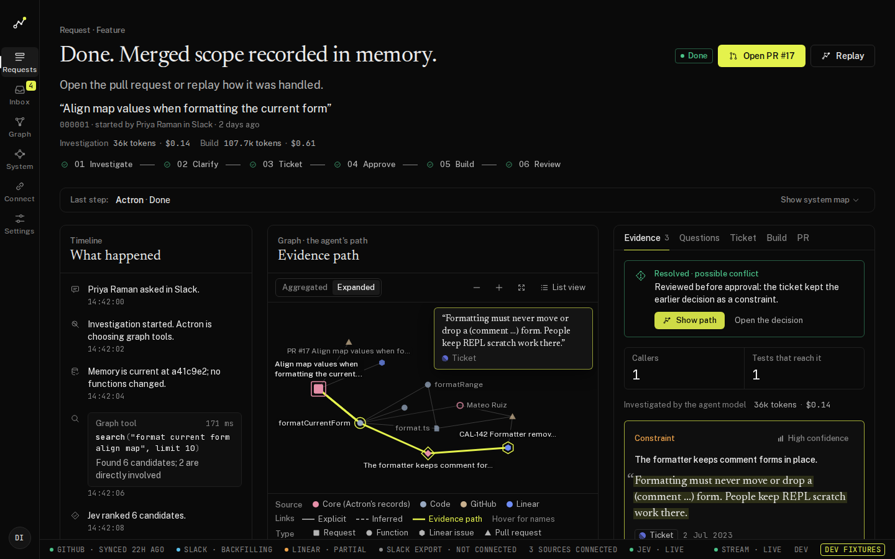
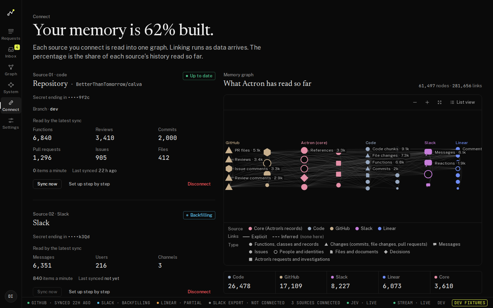
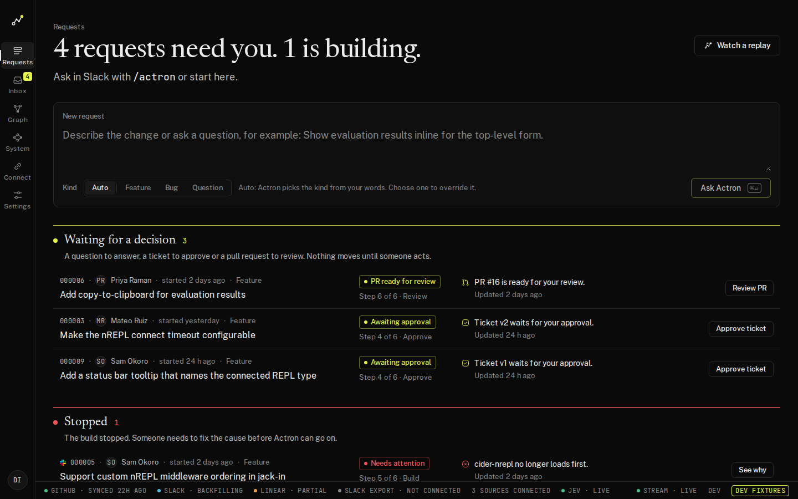

# Actron web UI

Next.js 16 (App Router), React 19, TypeScript strict, TanStack Query, Zustand for UI state, Tailwind over the CSS-variable tokens in `styles/tokens.css`. Design record: `../DESIGN.md`; alternatives: `../DESIGN-DIRECTIONS.md`. Spec: `../specs/C-experience.md`.

## Run

| Command | What it does |
|---|---|
| `npm run dev` | dev server on :3000; `/api`, `/slack`, `/webhooks` are proxied to `API_INTERNAL_URL` (default `http://127.0.0.1:8080`) |
| `NEXT_PUBLIC_ACTRON_DEV_FIXTURES=1 npm run dev` | same, but every API call is answered by the MSW fixtures in `tests/fixtures/` and a DEV FIXTURES badge shows on every screen |
| `npm run build` / `npm start` | production build (`output: 'standalone'`) |
| `npm run build:fixtures` | fixture build into `.next-fixtures/` for the end-to-end tests and screenshots |
| `npm run typecheck`, `npm run lint`, `npm test` | TypeScript, ESLint, Vitest |
| `npm run test:e2e` | Playwright against `next start` on the fixture build (port 3100); set `E2E_BASE_URL` to run against a real stack |
| `npx tsx scripts/capture-screens.ts` | screenshots of every screen at 1440 and 1920 into `tests/screenshots/`, and the landing journey crops into `public/landing/` |
| `npm run lhci` | Lighthouse CI on a production build (`lighthouserc.json`; mobile landing: `lighthouserc.mobile.json`) |
| `npm run gen:types` | regenerate `lib/api/openapi.d.ts` from `lib/api/openapi.json` (see the header of `lib/api/types.ts`) |

Fixture scenarios: add `?fixture=empty` (first run), `?fixture=backend-down` or `?fixture=stream-drop` to any URL in fixture mode.

## Screenshots

Captured from the fixture build (`tests/screenshots/`, each at `-1440.png` and `-1920.png`):

| Screen | Files |
|---|---|
| Landing | `landing` |
| Sign in | `signin` |
| Home | `home`, `home-empty`, `home-backend-down` |
| Connect | `connect`, `connect-empty`, `connect-guide` |
| Request | `request-live-investigating`, `request-done-evidence`, `request-done-path`, `request-stale-ticket`, `request-building`, `request-failed`, `request-pr-ready`, `request-cancelled`, `request-answered`, `request-nothing-found` |
| Replay | `replay`, `public-replay` |
| Inbox | `inbox` |
| Graph explorer | `graph` |
| System | `system` |
| Settings | `settings` |
| Command palette | `palette` |
| 404 | `not-found` |
| Glyphs | `glyphs` |

